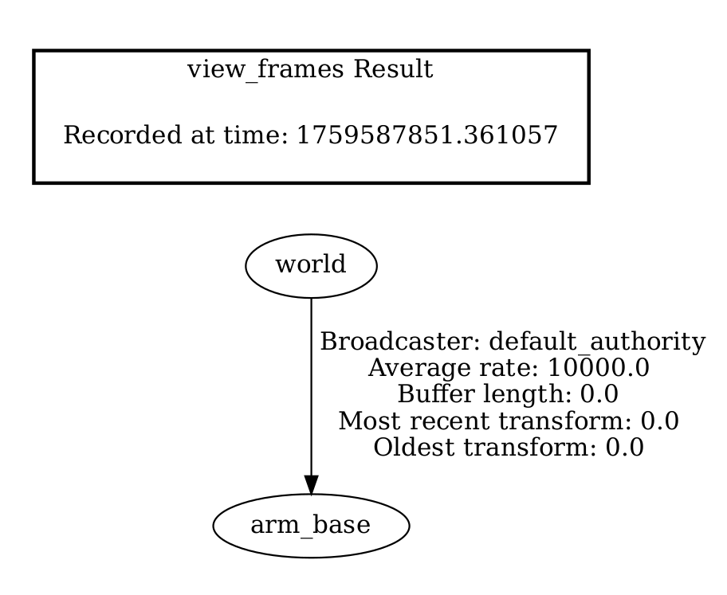
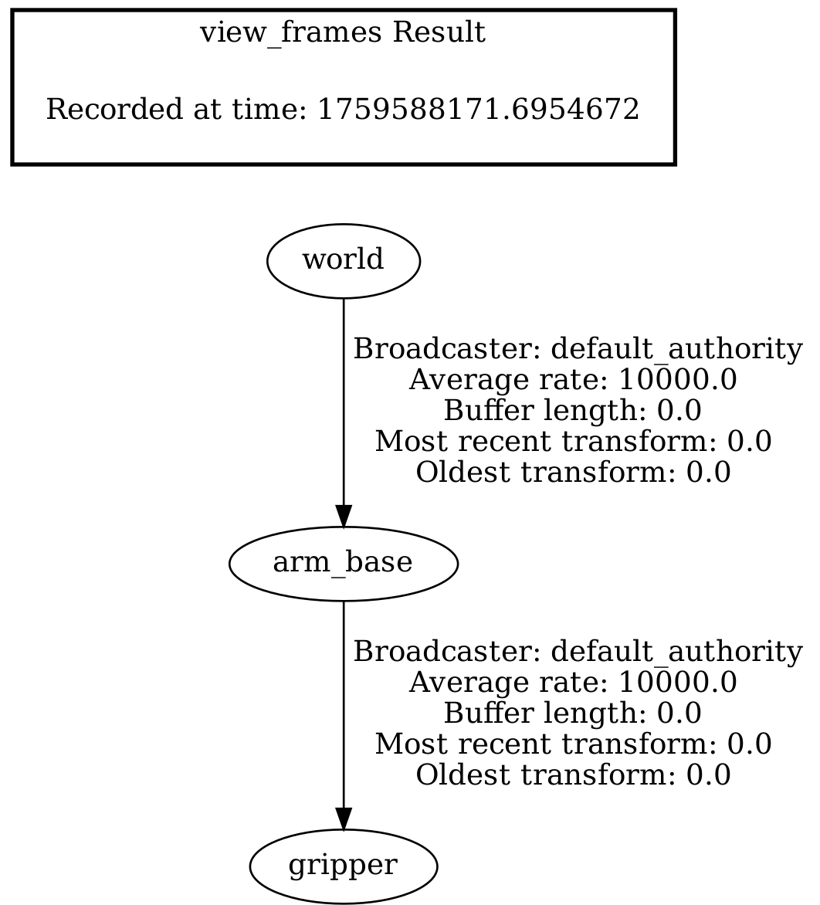
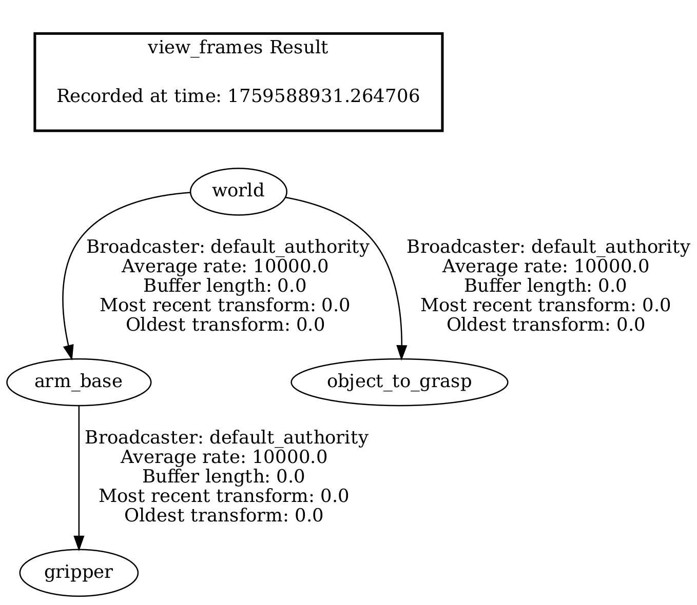

# Transforms (tf2) in ROS
Transformation is an important part of robotics. In robots, you have different parts that are connected to the robot through different joints (e.g., sensor, link, arms, etc). You need to know the coordinates of those parts relative to some frame. For e.g., you need to know how far the robot arm is relative to the base position. The way to do that is to compute transformation matrix that transforms your arm frame to base frame.

Doing that for every single joints in robots gets tedious really quick. To not do that manually for each joint, you can use `tf2` package in ROS.  `tf2` is the ROS tool that keeps track of all these frames and calculates how they relate to each other.

But first, you have to tell the `tf2` package how each joint is connected to other joints.

## 1. Defining the world and robot’s base:

Everything needs an origin point. In ROS, this is conventionally called a frame called `world`. Let’s define the position of our robot’s base relative to this `world`. There’s a tool in `tf2` package called `static_transform_publisher`, which you can use to define static transforms (transforms for that doesn’t move with respect to the link that it is connected to, for e.g., fixed joints in robots’ body).

In a terminal run this command:

```markdown
ros2 run tf2_ros static_transform_publisher --x 1 --y 0 --z 0 --roll 0 --pitch 0 --yaw 0.785 --frame-id world --child-frame-id arm_base
```

- `--x 1 --y 0 --z 0` : This places `arm_base` at position (1, 0, 0) relative to the `world`.
- `--yaw 0.785`: This gives it a rotation of 0.785 radians (about 45 degrees) around the z-axis.
- `--frame-id world` : This is **parent** frame. We are defining our position relative to the `world`.
- `--child-frame-id arm_base`: This is the **child** frame. We are defining position of the arm’s base.

This command will run continuously, *broadcasting* this transform to the rest of the ROS2 system.

You can verify if this transform is broadcasted by using `tf2_echo` node in `tf2_ros` package:

```
ros2 run tf2_ros tf2_echo world arm_base
```

you’ll see something like this:

```markdown
At time 0.0
- Translation: [1.000, 0.000, 0.000]
- Rotation: in Quaternion (xyzw) [0.000, 0.000, 0.382, 0.924]
- Rotation: in RPY (radian) [0.000, -0.000, 0.785]
- Rotation: in RPY (degree) [0.000, -0.000, 44.977]
- Matrix:
  0.707 -0.707  0.000  1.000
  0.707  0.707  0.000  0.000
  0.000  0.000  1.000  0.000
  0.000  0.000  0.000  1.000
```

It gives you translation, rotations (in quaternion, radian, degrees), and transformation matrix.

You can also visualize the transform (TF tree), to see how things are connected by running `view_frames` node in `tf2_tools` package. In a new terminal type:

```markdown
ros2 run tf2_tools view_frames
```
<div class="blog-figure">
  
  <p>Output of view_frames in pdf. Adding arm base in the world</p>
</div>


## 2. Add a gripper on the arm_base

Now let’s define the position of a gripper relative to the `arm_base`. This demonstrates how transforms are chained together. In a new terminal, run the following command:

```markdown
ros2 run tf2_ros static_transform_publisher --x 0.5 --y 0 --z 0.2 --frame-id arm_base --child-frame-id gripper
```

Notice we are attaching `gripper` to `arm_base.`

In a new terminal, visualize the `tf_tree` again using `view_frames` :

```markdown
ros2 run tf2_tools view_frames
```

You’ll see something like this:

<div class="blog-figure">
  
  <p>adding gripper on base</p>
</div>

## 3. Automatically Computing Transformation Matrix using TF2

We defined `gripper` frame relative to the `arm_base [1.354, 0.353, 0.200]`, and never relative to the `world`. We can hand compute the relative transformation from `gripper` to `world` knowing that they are connected. But the whole point was this will become tedious when we have a robot with a lot of joints.

We have `tf2` to compute the transformation for us. Because `tf2` knows the whole chain, it can calculate it for us.

In a new terminal, you can run `ros2 run tf2_ros tf2_echo world gripper` to see the transformation like you did before.

You’ll get something like this:

```markdown
At time 0.0
- Translation: [1.354, 0.353, 0.200]
- Rotation: in Quaternion (xyzw) [0.000, 0.000, 0.382, 0.924]
- Rotation: in RPY (radian) [0.000, -0.000, 0.785]
- Rotation: in RPY (degree) [0.000, -0.000, 44.977]
- Matrix:
  0.707 -0.707  0.000  1.354
  0.707  0.707  0.000  0.353
  0.000  0.000  1.000  0.200
  0.000  0.000  0.000  1.000
```

Here you know that the `gripper` is at coordinates `[1.354, 0.353, 0.200]` w.r.t the `world` coordinate. Pretty cool.

## 4. Placing an Object in the World

Now, let’s define an object we want the arm to interact with. This object’s frame will also be a child of the `world` frame because the object is somewhere in the world. Run the following command in a new terminal:

```markdown
ros2 run tf2_ros static_transform_publisher --x 1.5 --y -0.5 --z 0.2 --frame-id world --child-frame-id object_to_grasp
```

Now, as expected, this should create a new branch in our tf tree from the `world` frame. Let’s verify it using the `view_frames` in a new terminal.

```markdown
ros2 run tf2_tools view_frames
```
<div class="blog-figure">
  
  <p>Adding object in the world</p>
</div>

You should see something similar to this. It tells you that in the world, you have object and arm base (with multiple joints)

## 5. Final Question: How do you move the object?

The most important question for a robot arm is: “What is the position of the `object_to_grasp` relative to my `gripper`? We know how to use`tf2` to answer this instantly.

In a new terminal, run the following command to get the answer:

```markdown
ros2 run tf2_ros tf2_echo gripper object_to_grasp
```

You’ll get something like this:

```markdown
At time 0.0
- Translation: [-0.500, -0.707, 0.000]
- Rotation: in Quaternion (xyzw) [0.000, 0.000, -0.382, 0.924]
- Rotation: in RPY (radian) [0.000, 0.000, -0.785]
- Rotation: in RPY (degree) [0.000, 0.000, -44.977]
- Matrix:
  0.707  0.707  0.000 -0.500
 -0.707  0.707 -0.000 -0.707
 -0.000  0.000  1.000  0.000
  0.000  0.000  0.000  1.000
```

`tf2` traverses the tree to find the answer. It goes from `gripper` up to its parent `arm_base`, then up to its parent `world`, and then down the other branch to `object_to_grasp`. The output of this command is the exact translation and rotation your robot needs to apply to its tool to reach the object_to_grasp.

>
## 💡 On a side note:
One thing that I just want to put it out there is when you run the `static_transform_publisher` to create a chain of transforms (i.e., from world→arm_base→gripper), and also (world→object_to_grasp), the way `tf2` knows about this is through ROS topics.
You can check this by doing `ros2 topic list` command. After you run one of the `static_transform_publisher` node, the `static_transform_publisher` node creates a topic called `\tf_static` where it publishes all the static transforms. If you have all the `static_transform_publisher` nodes, from above, running; you can verify the content the node is publishing through the command `ros2 topic echo /tf_static` in a new terminal. You’ll something like below:
```
transforms:
- header:
    stamp:
      sec: 1759587429
      nanosec: 816690229
    frame_id: world
  child_frame_id: arm_base
  transform:
    translation:
      x: 1.0
      y: 0.0
      z: 0.0
    rotation:
      x: 0.0
      y: 0.0
      z: 0.3824994972760097
      w: 0.9239556994702721
---
transforms:
- header:
    stamp:
      sec: 1759588151
      nanosec: 829305418
    frame_id: arm_base
  child_frame_id: gripper
  transform:
    translation:
      x: 0.5
      y: 0.0
      z: 0.2
    rotation:
      x: 0.0
      y: 0.0
      z: 0.0
      w: 1.0
---
transforms:
- header:
    stamp:
      sec: 1759588850
      nanosec: 853191917
    frame_id: world
  child_frame_id: object_to_grasp
  transform:
    translation:
      x: 1.5
      y: -0.5
      z: 0.2
    rotation:
      x: 0.0
      y: 0.0
      z: 0.0
      w: 1.0
---
```
Here you see how each `frame_id` is connected to `child_frame_id`.
Using `static_transform_publisher` to describe a robot’s design, one piece at a time is not always feasible. In the next tutorial, we will talk about `urdf` file and `robot_state_publisher` that to do it automatically.
>
